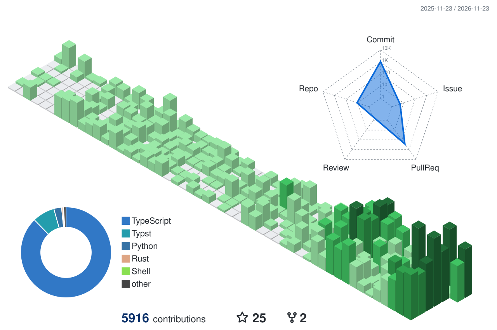

# Xingyu Yang (Eric)

Final-year CS student at Monash University Malaysia and **incoming Honours student (2027)** with **[Prof. Raphaël C.-W. Phan](https://raphaelphan.github.io/research/)** at the School of Information Technology. I work where linguistics, mathematics, and computer science meet: representation learning, learning theory, and how learning systems come to carry structure.

## Now

- **Incoming Honours student (2027), Monash University Malaysia**, supervised by [Prof. Raphaël C.-W. Phan](https://raphaelphan.github.io/research/). The main focus is 3D vision. Alongside it I am exploring other directions, including agents that use formal verifiers as tools to check their own work.
- **Final-year project: comfort-aware 2D-to-3D video conversion**, with an emphasis on evaluation, controllability, and human viewing constraints. Being written up as a paper.
- **Previously:** AI intern at Xiaohongshu (RedNote), Nov 2025 to Feb 2026, building an agentic GUI testing system for mobile apps and other agentic systems.

## Research Direction

My long-term interest sits at the intersection of **linguistics, mathematics, and computer science**. I want to understand what structure a learner picks up from its data, how much evidence that takes, and how we can check what it has actually learned. The questions I keep returning to:

- **Representation learning**: how vision, language, geometry, and 3D signals can share structure without collapsing into shallow alignment.
- **Learning theory**: how much data, and what kind of feedback, a learner needs; and how to tell a learner that got less evidence from one that used its evidence poorly.
- **Language and meaning**: how linguistic structure and formal semantics show up, or fail to show up, inside learned models.
- **Interpretability**: how to inspect model behavior without reducing explanation to saliency maps or post-hoc stories.
- **3D vision and world models**: how models organize objects, geometry, and the latent rules of a world.

I still build software, mostly because it gives me better instruments for research and writing.

## Open-Source Work

| Project | What it is |
|---|---|
| [algorithm-visualizer](https://github.com/Eryc123Y/algorithm-visualizer) · [AlgoMotion](https://algomotion.turing2234.com) | Every step of an algorithm, drawn: a web player, Typst and LaTeX figures, slides, a CLI and an MCP server, from one algorithm name and your input. |
| [unofficial-monash-slides-typst](https://github.com/Eryc123Y/unofficial-monash-slides-typst) | Monash-inspired slide theme for Typst, built on Touying. On [Typst Universe](https://typst.app/universe/package/unofficial-monash-touying). |
| [unofficial-monash-report](https://github.com/Eryc123Y/unofficial-monash-report) | Typst template for Monash STEM assignments and reports. |
| [scholia](https://github.com/Eryc123Y/scholia) | Fill-in study notes and book template for STEM, built for active recall. |
| [nix-sync](https://github.com/Eryc123Y/nix-sync) | One Nix repository for macOS, NixOS, and Linux: shared tools and dotfiles, platform-specific settings. |
| [personal-skills](https://github.com/Eryc123Y/personal-skills) | Claude Code skills for research work: paper figures, analysis, diagramming. |
| [Math-for-Computer-Science](https://github.com/Eryc123Y/Math-for-Computer-Science) | A math resource for CS students (archived; the content is moving to my [blog](https://eryc123y.github.io/blog/)). |

## Research and Engineering Stack

**AI / data**

**Research writing**

**Systems and workflow**

**Web surfaces**

## Recent Activity

  <picture>
    <source media="(prefers-color-scheme: dark)" srcset="https://raw.githubusercontent.com/Eryc123Y/Eryc123Y/main/profile-3d-contrib/night.svg">
    <source media="(prefers-color-scheme: light)" srcset="https://raw.githubusercontent.com/Eryc123Y/Eryc123Y/main/profile-3d-contrib/day.svg">
    
  </picture>

